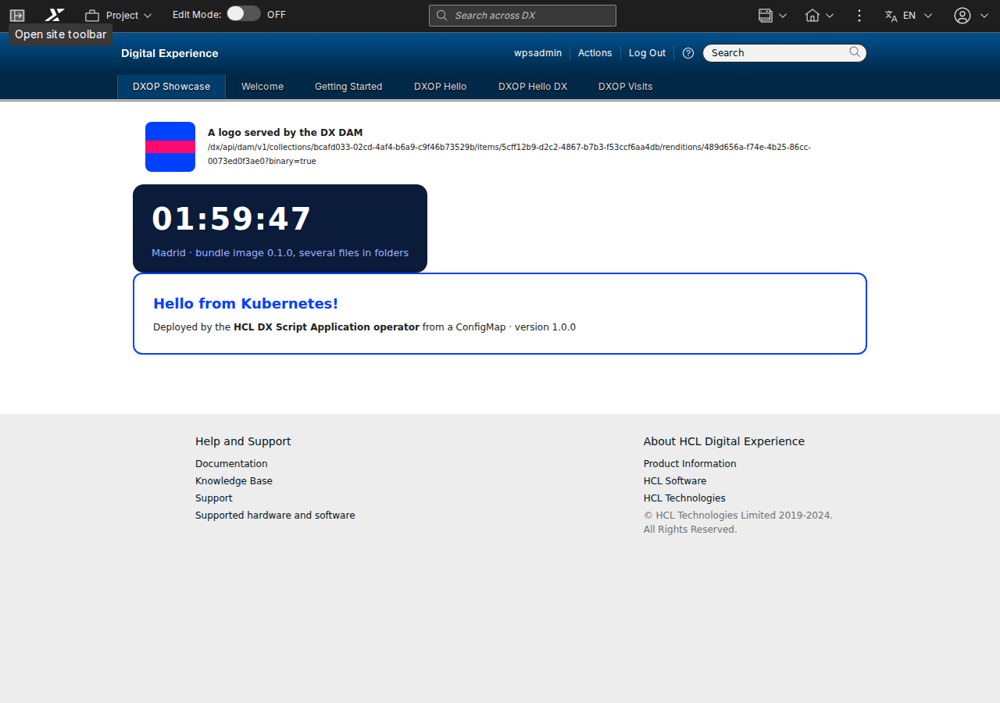

# Operador de Script Applications para HCL DX

[English](README.md) · [Historial de versiones](CHANGELOG.es.md)

**Un operador de Kubernetes que despliega Script Applications de HCL DX y las mantiene en DX tal como se
declaran: la aplicación en WCM, sus páginas, sus ficheros del DAM y la base de datos de su backend. Se declara
en YAML (o en Git, con ArgoCD); el operador hace el resto, revisa DX periódicamente y vuelve a dejar lo que
alguien cambió o borró.**

```yaml
apiVersion: dx.europesip.com/v1alpha1
kind: DXScriptApplication
metadata:
  name: vacaciones
spec:
  connectionRef: { name: dx }
  source:
    image: { ref: ghcr.io/acme/vacaciones:2.3.0, path: /app }   # la app compilada (dist/)
  wcm: { title: "Vacaciones" }
  substitutions:
    - { name: API_URL, value: /vacaciones-api }                 # ${API_URL} en los ficheros
  dependsOn:
    - { kind: Deployment, name: vacaciones-api }                # solo se sube cuando el backend está listo
---
apiVersion: dx.europesip.com/v1alpha1
kind: DXPage
metadata:
  name: vacaciones
spec:
  connectionRef: { name: dx }
  titles: { es: "Vacaciones", en: "Time off" }
  applications: [{ name: vacaciones }]
```

No es un producto de HCL. Probado en HCL DX Compose CF239 (Kubernetes 1.35, DXClient `v95_CF239_20261103-1404`).

## Por qué existe

En HCL DX Compose las aplicaciones a medida son **Script Applications** (los portlets Java a medida necesitan el
Java Transition Module, que se licencia aparte). HCL las despliega con **DXClient**, una herramienta de línea de
comandos: un push desde un puesto o un job de CI. Basta para una aplicación sencilla, pero una aplicación real es
más que un push:

- su **backend**: microservicios y una base de datos, que deben estar listos antes;
- sus **páginas** en DX, con la aplicación puesta (XMLAccess);
- sus **imágenes y ficheros** en el DAM, y sus URL dentro de la aplicación;
- valores distintos por entorno (URL, opciones), sin volver a compilarla.

EUROPESIP primero envolvió el push en un chart de Helm ([hcl-dx-scriptapp-helm](https://github.com/europesip/hcl-dx-scriptapp-helm):
un Job con DXClient como hook de Helm) y después construyó [ÓRBITA](https://github.com/europesip/orbita), una
intranet con seis Script Applications, una API REST, PostgreSQL, páginas, un tema e imágenes del DAM, con el
mismo modelo (un script posterior al push). Funciona, pero dejó claros los límites de un paso imperativo dentro
de una herramienta declarativa:

- **Nada en Kubernetes conoce el estado en DX.** El Job se ejecuta una vez y desaparece. Si alguien borra o
  edita la aplicación en WCM, o se reinstala DX, nadie se entera y nadie lo corrige.
- **Cada cambio es una ejecución completa.** Helm (y ArgoCD, que convierte los hooks en hooks de sync) ejecuta
  el Job en cada upgrade o sync, haya cambios o no.
- **El resultado solo está en un log**: el content ID, las páginas, las URL del DAM.
- **Borrar es manual**: `helm uninstall` deja en DX la aplicación, las páginas y los ficheros.
- **Cada aplicación nueva necesita su chart y sus scripts** para páginas, DAM y base de datos.

El operador convierte esos pasos en **recursos con un estado deseado y un status**, reconciliados continuamente.

## Qué hace

| Recurso | Qué hace el operador |
|---|---|
| **DXConnection** | Comprueba que DX responde y acepta las credenciales (un Secret y, si hace falta, una CA). La comparten los recursos de un namespace; fija cada cuánto se revisa todo contra DX (`resyncInterval`) |
| **DXScriptApplication** | Toma los ficheros compilados de una **imagen OCI** (leída directamente del registro: no se ejecuta nada), de un **ConfigMap** o de una **URL** de un archivo; sustituye los `${NOMBRE}` (valores, ConfigMaps, Secrets, URL de ficheros del DAM); comprueba los límites de WCM; **hace el push** con DXClient solo cuando algo cambió; la restaura si se **borró o editó en DX**; la quita de DX al borrarla si se pide |
| **DXPage** | Crea la página con sus Script Applications (XMLAccess): títulos por idioma, acceso, tema, posición. Conserva el layout y los ajustes que la gente haga en ella entre actualizaciones; la **vuelve a crear** si se borró en DX |
| **DXDamCollection** | Crea la colección y sube cada fichero de su origen; un fichero cambiado pasa a ser **una versión nueva del mismo asset** (misma URL); restaura los borrados; acceso público o de usuarios autenticados; limpieza opcional |
| **DXTheme** | Un **tema**: sube al almacén WebDAV los ficheros de su origen (un tema propio completo, como el [tema de ejemplo de EUROPESIP](https://github.com/europesip/hcl-dx-theme-sample), o ficheros que se añaden a una copia de un tema del mismo DX), HTML opcional en el `<head>` de sus plantillas, y lo registra con XMLAccess. Las páginas lo usan con `spec.theme`; se restaura si se borra su registro o su carpeta en DX |
| **DXDatabase** | Crea la base de datos de un backend y su propietario en un **PostgreSQL, Oracle o SQL Server** existente, y escribe un **Secret** para el backend (`uri`, `jdbcUrl`, usuario, contraseña...). La contraseña se genera una vez y se conserva |

Y en todos los recursos: **dependencias** (`dependsOn`: Deployments, StatefulSets, Jobs y los demás recursos; no
se sube nada hasta que el backend está listo), **política de deriva** (`Restore`, por defecto, o `Report`),
**política de borrado** (`Retain`, por defecto, o `Delete`), `suspend`, un **status** con condiciones, **eventos
de Kubernetes** de todo lo que hace en DX y una anotación para forzar una reconciliación al momento.

### Frente al chart de Helm y su Job

| | Chart de Helm con un Job de DXClient | Operador |
|---|---|---|
| Subir la aplicación | En cada install/upgrade, siempre | **Solo si algo cambió** (hash de ficheros y ajustes) |
| Saber si está en DX | No (log de un Job terminado) | **Sí**: status, condiciones, eventos, `kubectl get` |
| Borrada o editada en DX, DX reinstalado | No se detecta | **Se detecta y se restaura** en la siguiente revisión |
| Páginas, DAM, base de datos | Scripts a medida por aplicación | **Recursos declarativos**, reutilizables |
| La misma compilación en todos los entornos | Valores dentro de la compilación o del chart | `substitutions` por entorno |
| Orden (primero el backend) | Pesos de los hooks | `dependsOn`, esperas y reintentos |
| Quitarla de DX al desinstalar | A mano | `deletionPolicy: Delete` |
| GitOps (ArgoCD) | Hooks en cada sync, sin salud | Recursos normales **con salud** (ver abajo) |
| Varios push a la vez contra un DX | Los Jobs pueden chocar | **Serializados** por el operador |

El chart de Helm sigue siendo buena opción para una aplicación que se instala una vez; el operador compensa con
varias aplicaciones, varios entornos, GitOps, o cuando hay que mantener DX tal como se declara.

## Instalación

Hace falta Kubernetes 1.28+ y Helm 3.8+ (o 4). **Sin login en ningún registro**: el chart y la imagen son públicos.

La imagen del operador se construye **sobre la imagen pública de DXClient de HCL**, así que contiene HCL DXClient,
que es software de HCL con su propia licencia ([LICENSE-DXClient.md](LICENSE-DXClient.md)). Léela y acéptala; si
no, el chart no se instala:

```bash
docker run --rm hclcr.io/dx-public/dxclient:v95_CF239_20261103-1404 /dxclient/bin/dxclient accept-license
```

```bash
helm upgrade --install dxop oci://ghcr.io/europesip/charts/hcl-dx-scriptapp-operator --version 0.3.0 \
  -n dxop-system --create-namespace --set dxclient.acceptLicense=true
```

Valores: [values.yaml](charts/hcl-dx-scriptapp-operator/values.yaml), por ejemplo `watchNamespaces` para limitar
el operador a algunos namespaces.

## Uso

En el namespace de tus aplicaciones, un usuario de DX y (solo con un certificado autofirmado o de una CA privada)
su CA:

```bash
kubectl create namespace intranet
kubectl -n intranet create secret generic dx-admin --from-literal=username='<usuario de DX>' --from-literal=password='<contraseña>'
kubectl -n dx-demo get secret dx-tls-cert -o jsonpath='{.data.tls\.crt}' | base64 -d > dx-ca.crt   # labs: autofirmado
kubectl -n intranet create secret generic dx-ca --from-file=ca.crt=dx-ca.crt
```

El usuario necesita acceso de Editor a la Script Application Library; **las páginas y el DAM necesitan un
administrador de DX** (XMLAccess). Después, la conexión y tus recursos:

```yaml
apiVersion: dx.europesip.com/v1alpha1
kind: DXConnection
metadata: { name: dx }
spec:
  url: https://dx.example.com
  credentialsSecret: { name: dx-admin }
  caSecret: { name: dx-ca }
```

```bash
kubectl -n intranet get dxconnections                  # Ready = ha entrado en DX
kubectl -n intranet apply -f mi-app.yaml
kubectl -n intranet get dxscriptapplications,dxpages,dxdamcollections,dxdatabases
kubectl -n intranet get events --field-selector involvedObject.kind=DXScriptApplication
```

Forzar una reconciliación completa ahora (un push aunque no haya cambios):

```bash
kubectl -n intranet annotate scriptapplication vacaciones dx.europesip.com/reconcile="$(date +%s)" --overwrite
```

## Ejemplos

Aplicaciones pequeñas, cada una para un caso. Se aplican en un namespace con los dos Secrets y
[00-connection.yaml](samples/00-connection.yaml) (o todas juntas con `kubectl apply -k samples`):

| Ejemplo | Qué muestra |
|---|---|
| [01-hello](samples/01-hello/hello.yaml) | La más pequeña: un HTML en un ConfigMap, sustituciones y una página |
| [02-image](samples/02-image/hello-dx.yaml) | Una aplicación React real ([Hello DX](https://github.com/europesip/hcl-dx-scriptapp-helm)) desde una imagen |
| [03-dam](samples/03-dam/dam.yaml) | Un logo en el DAM (público) y su URL en la aplicación, que espera a la colección |
| [04-backend-db](samples/04-backend-db/visits.yaml) | Un backend ([Go](samples/04-backend-db/visits-api)) con su propia base de datos PostgreSQL, publicado en el host de DX; la aplicación lo espera |
| [05-bundle-image](samples/05-bundle-image) | Una imagen con varios ficheros en carpetas (HTML, CSS, JS): la misma compilación para todos los entornos |
| [06-url](samples/06-url/url.yaml) | Una aplicación desde una URL `.tar.gz` (un tag de GitHub), con su SHA256 |
| [07-verify](samples/07-verify/verify.yaml) | `mode: Verify`: solo comprueba que la aplicación está en DX (entornos con sindicación) |
| [08-page](samples/08-page/page.yaml) | Una página con tres aplicaciones, una posición y una política de borrado |
| [09-theme](samples/09-theme/theme.yaml) | Un tema propio (el [tema de ejemplo de EUROPESIP](https://github.com/europesip/hcl-dx-theme-sample), desde su release) y una página que lo usa |



## GitOps con ArgoCD

Los recursos son objetos de Kubernetes normales: van en Git y una Application de ArgoCD apunta a ellos. ArgoCD
los aplica; el operador hace el trabajo en DX y lo refleja en el status. Con los health checks de
[examples/argocd](examples/argocd), ArgoCD los muestra como Progressing, Healthy o Degraded; ahí está también la
Application de ejemplo. Publicar una versión nueva de una aplicación es un commit que cambia la etiqueta (o el
digest) de su imagen.

## Cómo funciona

Cada recurso se compara con DX en cada cambio y cada `resyncInterval`. Una Script Application solo se sube cuando
cambia el hash de sus ficheros preparados y sus ajustes, cuando DX ya no la tiene (Ring API, por content ID) o
cuando se modificó allí (cambió su fecha de última modificación). Los push ejecutan DXClient dentro del operador,
de uno en uno; las páginas y el DAM usan directamente el endpoint de XMLAccess y la API REST del DAM. Detalle:
[docs/how-it-works.es.md](docs/how-it-works.es.md). Todos los campos: [docs/reference.md](docs/reference.md).

## Restricciones y limitaciones

Las importantes (todas en [docs/limitations.es.md](docs/limitations.es.md)):

- **El HTML principal debe ser un documento completo** (`<html><head>…</head><body>…</body></html>`): DXClient
  conserva los `<link>` y `<script>` del `<head>` y el contenido del `<body>`. Un fragmento suelto pierde su
  elemento exterior y sus enlaces.
- **Cada fichero tiene un límite de 4,5 MB** (WCM guarda cada uno en un elemento de 5.000.000 bytes como máximo);
  el operador rechaza los mayores antes de tocar DX.
- **Las páginas anónimas** necesitan que los usuarios anónimos tengan el rol User en la Script Application
  Library: el operador no puede fijar permisos de elementos de WCM.
- Una Script Application restaurada tras **borrarse** en DX recibe un **content ID nuevo**; sus páginas se
  reconstruyen solas (con los ajustes por defecto).
- Cambiar la **lista de aplicaciones de una página** la vuelve a crear (DX no permite sustituir sus componentes).
- **Push o sindicación, por entorno**: donde el contenido llega por sindicación, `mode: Verify`.
- Los cambios hechos en DX a una aplicación gestionada o a los ajustes de una página **se sobrescriben**
  (`driftPolicy: Restore`); usa `Report` donde se edite en DX.
- Una réplica activa (leader election); los push se serializan.

## Seguridad

- Las credenciales de DX están en Secrets. DXClient las recibe en su fichero de configuración durante cada push
  (nunca en la línea de comandos, como recomienda DXClient) y el fichero se borra después; las contraseñas se
  ocultan en los logs.
- El operador corre como usuario no root y sin privilegios. Puede leer los Secrets y ConfigMaps de los namespaces
  que vigila (limítalos con `watchNamespaces`) y necesita un usuario de DX con los permisos de lo que declares.
- Los valores de `substitutions` acaban en ficheros que cualquier visitante puede descargar: nunca pongas
  credenciales ahí.

## Desarrollo

```bash
make manifests generate && ./hack/sync-chart.sh   # tras cambiar api/
go test ./internal/...
make install                                      # los CRD en el clúster actual
DXCLIENT_HOME=<carpeta de dxclient> DXCLIENT_ACCEPT_LICENSE=true go run ./cmd --leader-elect=false
```

Para ejecutarlo fuera de un contenedor, extrae `/dxclient` de la imagen de DXClient
(`crane export ... | tar -x dxclient`) y usa Node.js 24.

## Licencia

MIT ([LICENSE](LICENSE)) para este repositorio. La imagen del operador contiene HCL DXClient con la licencia de
HCL ([LICENSE-DXClient.md](LICENSE-DXClient.md)). HCL, HCL Digital Experience y DXClient son marcas de HCL
Technologies Ltd. Hecho por [EUROPESIP](https://www.europesip.com).
