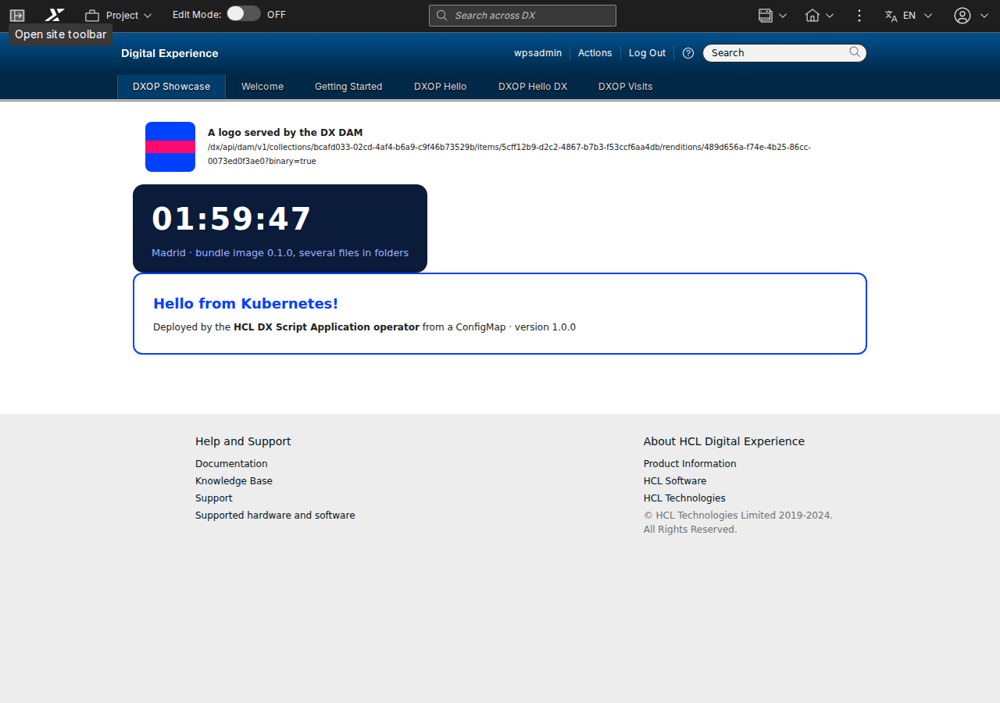

# HCL DX Script Application operator

[Español](README.es.md) · [Release history](CHANGELOG.md)

**A Kubernetes operator that deploys HCL DX Script Applications and keeps them in DX exactly as declared:
the application in WCM, its pages, its DAM files and the database of its backend. Declare it in YAML (or in
Git, with ArgoCD); the operator does the rest, checks DX regularly and puts back what someone changed or
deleted.**

```yaml
apiVersion: dx.europesip.com/v1alpha1
kind: DXScriptApplication
metadata:
  name: time-off
spec:
  connectionRef: { name: dx }
  source:
    image: { ref: ghcr.io/acme/time-off:2.3.0, path: /app }   # the built app (dist/)
  wcm: { title: "Time off" }
  substitutions:
    - { name: API_URL, value: /time-off-api }                 # ${API_URL} in the files
  dependsOn:
    - { kind: Deployment, name: time-off-api }                # push only when the backend is up
---
apiVersion: dx.europesip.com/v1alpha1
kind: DXPage
metadata:
  name: time-off
spec:
  connectionRef: { name: dx }
  titles: { en: "Time off", es: "Vacaciones" }
  applications: [{ name: time-off }]
```

```
$ kubectl get dxscriptapplications,dxpages
NAME                                          READY   REASON   CONTENT ID                             LAST PUSH
scriptapplication.dx.europesip.com/time-off   True    InSync   65f22d2a-8eed-4dfc-bd13-f3d1fce68143   3m
NAME                               UNIQUE NAME              READY   REASON
dxpage.dx.europesip.com/time-off   dxop.intranet.time-off   True    InSync
```

It is not an HCL product. Tested on HCL DX Compose CF239 (Kubernetes 1.35, DXClient `v95_CF239_20261103-1404`).

## Why it exists

On HCL DX Compose, custom applications are **Script Applications** (custom Java portlets need the separately
licensed Java Transition Module). HCL deploys them with **DXClient**, a command line tool: a push from a
workstation or a CI job. That works for one application, but a real one is more than a push:

- its **backend**: microservices and a database, which must be ready before the application is useful;
- its **pages** in DX, with the application on them (XMLAccess);
- its **images and files** in the DAM, and their URLs in the application;
- different values per environment (URLs, flags), without building it again.

EUROPESIP first wrapped the push in a Helm chart ([hcl-dx-scriptapp-helm](https://github.com/europesip/hcl-dx-scriptapp-helm):
a Job with DXClient as a Helm hook), then built [ÓRBITA](https://github.com/europesip/orbita), an intranet with
six Script Applications, a REST API, PostgreSQL, pages, a theme and DAM images, on the same model (an
after-push script). It works, but it showed the limits of an imperative step inside a declarative tool:

- **Nothing in Kubernetes knows the state in DX.** The Job runs once and is gone. If someone deletes or edits
  the application in WCM, or DX is reinstalled, nothing notices and nothing fixes it.
- **Every change is a full re-run.** Helm (and ArgoCD, which turns the hooks into sync hooks) runs the Job on
  every upgrade or sync, changed or not.
- **The result is only in a log**: the content ID, the pages, the DAM URLs.
- **Deleting is manual**: `helm uninstall` leaves the application, the pages and the files in DX.
- **Every new application needs its own chart and scripts** for pages, DAM and database.

The operator turns those steps into **resources with a desired state and a status**, reconciled continuously.

## What it does

| Resource | What the operator does |
|---|---|
| **DXConnection** | Checks that DX answers and accepts the credentials (a Secret, optionally a CA). Shared by the resources of a namespace; sets how often everything is checked against DX (`resyncInterval`) |
| **DXScriptApplication** | Gets the built files from an **OCI image** (read straight from the registry, nothing runs), a **ConfigMap** or an **archive URL**; replaces `${NAME}` placeholders (values, ConfigMaps, Secrets, URLs of DAM assets); checks the WCM limits; **pushes** with DXClient only when something changed; restores it if it was **deleted or edited in DX**; removes it on delete if asked |
| **DXPage** | Creates the page with its Script Applications (XMLAccess): titles by locale, access, theme, position. Keeps the layout and the settings people make on it across updates; **recreates** it if it was deleted in DX |
| **DXDamCollection** | Creates the collection and uploads every file of its source; a changed file becomes a **new version of the same asset** (same URL); restores deleted assets; public or authenticated access; optional prune |
| **DXTheme** | A **theme**: uploads the files of its source (a complete theme of its own, such as the [EUROPESIP sample theme](https://github.com/europesip/hcl-dx-theme-sample), or files added to a copy of a theme of the same DX) to the WebDAV store, optional HTML in the `<head>` of its templates, and registers it with XMLAccess. Pages use it with `spec.theme`; restored if its registration or folder is deleted in DX |
| **DXDatabase** | Creates the database of a backend and its owner in an existing **PostgreSQL, Oracle or SQL Server**, and writes a **Secret** for the backend (`uri`, `jdbcUrl`, user, password...). The password is generated once and kept |

And for every resource: **dependencies** (`dependsOn`: Deployments, StatefulSets, Jobs and the other resources,
so nothing is pushed until the backend is up), **drift policy** (`Restore`, the default, or `Report`),
**deletion policy** (`Retain`, the default, or `Delete`), `suspend`, a **status** with conditions,
**Kubernetes events** for everything it does in DX, and an annotation to force a reconciliation now.

### Compared with the Helm chart and its Job

| | Helm chart with a DXClient Job | Operator |
|---|---|---|
| Push the application | On every install/upgrade, always | **Only when something changed** (hash of files and settings) |
| Know if it is in DX | No (log of a finished Job) | **Yes**: status, conditions, events, `kubectl get` |
| Deleted or edited in DX, DX reinstalled | Unnoticed | **Detected and restored** on the next check |
| Pages, DAM, database | Custom scripts per application | **Declarative resources**, reusable |
| Same build in every environment | Values baked into the build or the chart | `substitutions` per environment |
| Order (backend first) | Hook weights | `dependsOn`, waits and retries |
| Remove from DX on uninstall | Manual | `deletionPolicy: Delete` |
| GitOps (ArgoCD) | Hooks re-run on every sync, no health | Plain resources with **health** (see below) |
| Concurrent pushes to one DX | Jobs can collide | **Serialised** by the operator |

The Helm chart is still a good choice for a single application installed once; the operator pays off with
several applications, several environments, GitOps, or when DX must be kept as declared.

## Install

You need Kubernetes 1.28+ and Helm 3.8+ (or 4). **No registry login**: the chart and the image are public.

The operator image is built **on top of HCL's public DXClient image**, so it contains HCL DXClient, which is
HCL software under its own licence ([LICENSE-DXClient.md](LICENSE-DXClient.md)). Read it and accept it, or the
chart refuses to install:

```bash
docker run --rm hclcr.io/dx-public/dxclient:v95_CF239_20261103-1404 /dxclient/bin/dxclient accept-license
```

```bash
helm upgrade --install dxop oci://ghcr.io/europesip/charts/hcl-dx-scriptapp-operator --version 0.3.1 \
  -n dxop-system --create-namespace --set dxclient.acceptLicense=true
```

Values: [values.yaml](charts/hcl-dx-scriptapp-operator/values.yaml), for example `watchNamespaces` to limit the
operator to some namespaces.

## Use it

In the namespace of your applications, a DX user and (only for a self-signed certificate or a private CA) its CA:

```bash
kubectl create namespace intranet
kubectl -n intranet create secret generic dx-admin --from-literal=username='<DX user>' --from-literal=password='<password>'
kubectl -n dx-demo get secret dx-tls-cert -o jsonpath='{.data.tls\.crt}' | base64 -d > dx-ca.crt   # labs: self-signed
kubectl -n intranet create secret generic dx-ca --from-file=ca.crt=dx-ca.crt
```

The user needs Editor access to the Script Application Library; **pages and DAM need a DX administrator**
(XMLAccess). Then the connection and your resources:

```yaml
apiVersion: dx.europesip.com/v1alpha1
kind: DXConnection
metadata: { name: dx }
spec:
  url: https://dx.example.com
  credentialsSecret: { name: dx-admin }
  caSecret: { name: dx-ca }
```

```bash
kubectl -n intranet get dxconnections                  # Ready = signed in to DX
kubectl -n intranet apply -f my-app.yaml
kubectl -n intranet get dxscriptapplications,dxpages,dxdamcollections,dxdatabases
kubectl -n intranet get events --field-selector involvedObject.kind=DXScriptApplication
```

Force a full reconciliation now (a push even if nothing changed):

```bash
kubectl -n intranet annotate scriptapplication time-off dx.europesip.com/reconcile="$(date +%s)" --overwrite
```

## Samples

Small applications, each one showing one case. Apply them in a namespace with the two Secrets and
[00-connection.yaml](samples/00-connection.yaml):

| Sample | What it shows |
|---|---|
| [01-hello](samples/01-hello/hello.yaml) | The smallest one: one HTML file in a ConfigMap, substitutions, a page |
| [02-image](samples/02-image/hello-dx.yaml) | A real React application ([Hello DX](https://github.com/europesip/hcl-dx-scriptapp-helm)) from a bundle image |
| [03-dam](samples/03-dam/dam.yaml) | A logo in the DAM (public) and its URL in the application, which waits for the collection |
| [04-backend-db](samples/04-backend-db/visits.yaml) | A backend ([Go](samples/04-backend-db/visits-api)) with its own PostgreSQL database, published on the DX host; the application waits for it |
| [05-bundle-image](samples/05-bundle-image) | A bundle image with several files in folders (HTML, CSS, JS), the same build for every environment |
| [06-url](samples/06-url/url.yaml) | An application from a `.tar.gz` URL (a GitHub tag), with its SHA256 |
| [07-verify](samples/07-verify/verify.yaml) | `mode: Verify`: only check that an application is in DX (syndicated environments) |
| [08-page](samples/08-page/page.yaml) | One page with three applications, a position and a deletion policy |
| [09-theme](samples/09-theme/theme.yaml) | A theme of its own (the [EUROPESIP sample theme](https://github.com/europesip/hcl-dx-theme-sample), from its release) and a page that uses it |



## GitOps with ArgoCD

The resources are plain Kubernetes objects: put them in Git and point an ArgoCD Application at them. ArgoCD
applies them; the operator does the work in DX and reports it in the status. Add the health checks of
[examples/argocd](examples/argocd) so ArgoCD shows them as Progressing, Healthy or Degraded; the example
Application is there too. Releasing a new version of an application is then a commit that changes its image tag
(or digest).

## How it works

Every resource is compared with DX on each change and every `resyncInterval`. A Script Application is pushed only
when the hash of its prepared files and settings changes, when DX no longer has it (Ring API, by content ID), or
when it was modified there (its last modification date changed). Pushes run DXClient inside the operator, one at
a time; pages and the DAM use DX's XMLAccess endpoint and DAM REST API directly. Details:
[docs/how-it-works.md](docs/how-it-works.md). Every field: [docs/reference.md](docs/reference.md).

## Restrictions and limitations

The important ones (all of them in [docs/limitations.md](docs/limitations.md)):

- **The main HTML file must be a complete document** (`<html><head>…</head><body>…</body></html>`): DXClient
  keeps the `<link>` and `<script>` of the `<head>` and the content of the `<body>`. A bare fragment loses its
  outer element and its links.
- **Each file is limited to 4.5 MB** (WCM stores each in one element of at most 5,000,000 bytes); the operator
  refuses bigger files before touching DX.
- **Anonymous pages** need anonymous users to have the User role on the Script Application Library: the operator
  cannot set WCM item permissions.
- A Script Application restored after being **deleted** in DX gets a **new content ID**; its pages are rebuilt
  automatically (with their default settings).
- Changing the **list of applications of a page** recreates the page (DX cannot replace its components in place).
- **Push or syndication, per environment**: where content arrives by syndication, use `mode: Verify`.
- Edits made in DX to a managed application or to page settings are **overwritten** (`driftPolicy: Restore`);
  use `Report` where people edit in DX.
- One active replica (leader election); pushes are serialised.

## Security

- The DX credentials stay in Secrets. DXClient gets them in its configuration file during each push (never on a
  command line, as DXClient recommends) and the file is removed afterwards; passwords are redacted from logs.
- The operator runs as a non-root user without privileges. It can read the Secrets and ConfigMaps of the
  namespaces it watches (limit them with `watchNamespaces`) and needs a DX user with the rights of what you declare.
- Values of `substitutions` end up in files every visitor can download: never put credentials there.

## Development

```bash
make manifests generate && ./hack/sync-chart.sh   # after changing api/
go test ./internal/...
make install                                      # the CRDs into the current cluster
DXCLIENT_HOME=<dxclient folder> DXCLIENT_ACCEPT_LICENSE=true go run ./cmd --leader-elect=false
```

To run it outside a container, extract `/dxclient` from the DXClient image (`crane export ... | tar -x dxclient`)
and use Node.js 24.

## Licence

MIT ([LICENSE](LICENSE)) for this repository. The operator image contains HCL DXClient under HCL's licence
([LICENSE-DXClient.md](LICENSE-DXClient.md)). HCL, HCL Digital Experience and DXClient are trademarks of HCL
Technologies Ltd. Made by [EUROPESIP](https://www.europesip.com).
