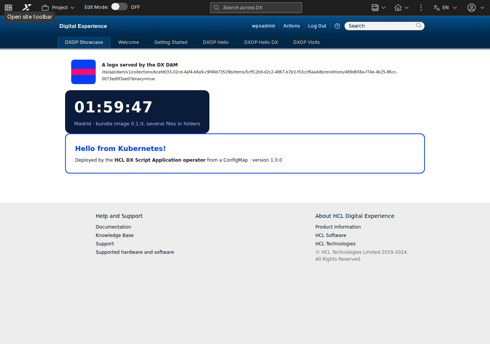

# Operador de Script Applications para HCL DX

[English](index.md) · **Español**

Un **operador de Kubernetes** de EUROPESIP que despliega Script Applications de HCL DX y las mantiene en DX tal como
se declaran: la aplicación en WCM, sus páginas, sus ficheros del DAM y la base de datos de su backend. Se declara en
YAML (o en Git, con ArgoCD); el operador hace el resto, revisa DX periódicamente y vuelve a dejar lo que alguien cambió
o borró. No es un producto de HCL. Probado en HCL DX Compose CF239 (Kubernetes 1.35, DXClient
`v95_CF239_20261103-1404`).



> Esta página es el resumen para el portal del desarrollador. La guía completa (instalación, uso, ejemplos, GitOps,
> seguridad, desarrollo) es el [README en GitHub](https://github.com/europesip/hcl-dx-scriptapp-operator/blob/main/README.es.md).

## Por qué existe

En HCL DX Compose las aplicaciones a medida son **Script Applications**, y HCL las despliega con **DXClient**, una
herramienta de línea de comandos: un push desde un puesto o un job de CI. Una aplicación real es más que un push: su
backend y su base de datos, sus páginas (XMLAccess), sus imágenes y ficheros en el DAM, y valores distintos por
entorno. Un push dentro de un Job de Helm ([hcl-dx-scriptapp-helm](https://github.com/europesip/hcl-dx-scriptapp-helm))
se ejecuta una vez y desaparece: nada en Kubernetes conoce el estado en DX, cada cambio es una ejecución completa, el
resultado solo está en un log y borrar es manual. El operador convierte esos pasos en **recursos con un estado deseado
y un status**, reconciliados continuamente.

```yaml
apiVersion: dx.europesip.com/v1alpha1
kind: DXScriptApplication
metadata:
  name: vacaciones
spec:
  connectionRef: { name: dx }
  source:
    image: { ref: ghcr.io/acme/vacaciones:2.3.0, path: /app }   # la app compilada (dist/)
  wcm: { title: "Vacaciones" }
  substitutions:
    - { name: API_URL, value: /vacaciones-api }                 # ${API_URL} en los ficheros
  dependsOn:
    - { kind: Deployment, name: vacaciones-api }                # solo se sube cuando el backend está listo
```

## Qué hace

| Recurso | Qué hace el operador |
|---|---|
| **DXConnection** | Comprueba que DX responde y acepta las credenciales (un Secret y, si hace falta, una CA); fija cada cuánto se revisa todo contra DX (`resyncInterval`) |
| **DXScriptApplication** | Toma los ficheros compilados de una imagen OCI, de un ConfigMap o de una URL de un archivo; sustituye los `${NOMBRE}`; **hace el push** con DXClient solo cuando algo cambió; la restaura si se borró o editó en DX |
| **DXPage** | Crea la página con sus Script Applications (XMLAccess): títulos por idioma, acceso, tema, posición; la vuelve a crear si se borró en DX |
| **DXDamCollection** | Crea la colección y sube cada fichero; un fichero cambiado pasa a ser una versión nueva del mismo asset (misma URL) |
| **DXTheme** | Sube un tema al almacén WebDAV y lo registra con XMLAccess; las páginas lo usan con `spec.theme` |
| **DXDatabase** | Crea la base de datos de un backend y su propietario en un PostgreSQL, Oracle o SQL Server existente, y escribe un Secret para el backend |

Y en todos los recursos: **dependencias** (`dependsOn`), **política de deriva** (`Restore` o `Report`),
**política de borrado** (`Retain` o `Delete`), `suspend`, un **status** con condiciones y **eventos de
Kubernetes**. Con los health checks de [examples/argocd](https://github.com/europesip/hcl-dx-scriptapp-operator/tree/main/examples/argocd), ArgoCD muestra los recursos
como Progressing, Healthy o Degraded. El chart de Helm sigue siendo buena opción para una aplicación que se instala una
vez; el operador compensa con varias aplicaciones, varios entornos, GitOps, o cuando hay que mantener DX tal como se
declara.

## Requisitos

| | |
|---|---|
| **Kubernetes y Helm** | Kubernetes 1.28+ y Helm 3.8+ (o 4). Sin login en ningún registro: el chart y la imagen son públicos |
| **Licencia de HCL DXClient** | La imagen del operador se construye sobre la imagen pública de DXClient de HCL, así que contiene HCL DXClient, software de HCL con su propia licencia ([LICENSE-DXClient.md](https://github.com/europesip/hcl-dx-scriptapp-operator/blob/main/LICENSE-DXClient.md)): léela y acéptala; si no, el chart no se instala |
| **Un usuario de DX** | Acceso de Editor a la Script Application Library; las páginas y el DAM necesitan un administrador de DX (XMLAccess). Su CA solo con un certificado autofirmado o de una CA privada |

## Instalación, en resumen

```bash
helm upgrade --install dxop oci://ghcr.io/europesip/charts/hcl-dx-scriptapp-operator --version 0.3.2 \
  -n dxop-system --create-namespace --set dxclient.acceptLicense=true
```

Después, en el namespace de tus aplicaciones, un Secret con el usuario de DX, un `DXConnection` y tus recursos. Paso a
paso: [Uso](https://github.com/europesip/hcl-dx-scriptapp-operator/blob/main/README.es.md#uso). Valores:
[values.yaml](https://github.com/europesip/hcl-dx-scriptapp-operator/blob/main/charts/hcl-dx-scriptapp-operator/values.yaml). Ejemplos, desde un HTML en un ConfigMap
hasta un backend con su propia base de datos y un tema: [samples/](https://github.com/europesip/hcl-dx-scriptapp-operator/tree/main/samples).

## Más documentación

| | |
|---|---|
| [Cómo funciona](how-it-works.es.md) | Las piezas, el bucle de reconciliación de cada recurso, concurrencia, status y eventos |
| [Restricciones y limitaciones](limitations.es.md) | Lo que DX permite y lo que el operador no puede hacer (documentos HTML completos, 4,5 MB por fichero, páginas anónimas...) |
| [Referencia de la API](reference.md) (en inglés) | Todos los campos de todos los recursos, generada a partir de los CRD |
| [Cómo trabajamos](workflow.es.md) | Issues, el tablero del proyecto y las especificaciones |
| Código, versiones, hoja de ruta | [GitHub](https://github.com/europesip/hcl-dx-scriptapp-operator) · [Historial de versiones](https://github.com/europesip/hcl-dx-scriptapp-operator/blob/main/CHANGELOG.es.md) · [Hoja de ruta](https://github.com/orgs/europesip/projects/3) |

Licencia: [MIT](https://github.com/europesip/hcl-dx-scriptapp-operator/blob/main/LICENSE) para este repositorio; la imagen del operador contiene HCL DXClient con la
licencia de HCL. HCL, HCL Digital Experience y DXClient son marcas de HCL Technologies Ltd. Hecho por
[EUROPESIP](https://www.europesip.com).
