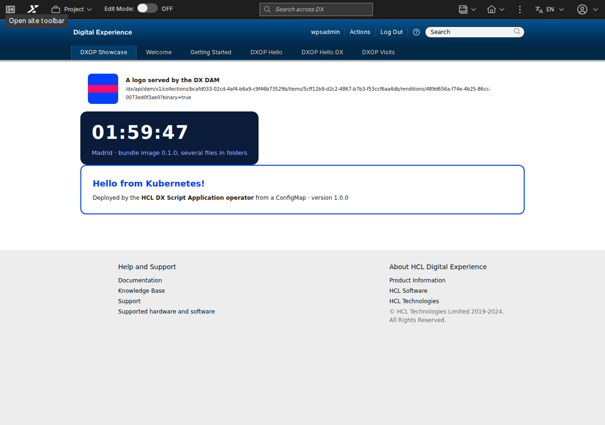

# HCL DX Script Application operator

**English** · [Español](index.es.md)

A **Kubernetes operator** by EUROPESIP that deploys HCL DX Script Applications and keeps them in DX exactly as
declared: the application in WCM, its pages, its DAM files and the database of its backend. Declare it in YAML (or in
Git, with ArgoCD); the operator does the rest, checks DX regularly and puts back what someone changed or deleted.
It is not an HCL product. Tested on HCL DX Compose CF239 (Kubernetes 1.35, DXClient `v95_CF239_20261103-1404`).



> This page is the summary for the developer portal. The full guide (install, use, samples, GitOps, security,
> development) is the [README on GitHub](https://github.com/europesip/hcl-dx-scriptapp-operator#readme).

## Why it exists

On HCL DX Compose, custom applications are **Script Applications**, and HCL deploys them with **DXClient**, a command
line tool: a push from a workstation or a CI job. A real application is more than a push: its backend and database,
its pages (XMLAccess), its images and files in the DAM, and different values per environment. A push wrapped in a
Helm Job ([hcl-dx-scriptapp-helm](https://github.com/europesip/hcl-dx-scriptapp-helm)) runs once and is gone: nothing
in Kubernetes knows the state in DX, every change is a full re-run, the result is only in a log and deleting is
manual. The operator turns those steps into **resources with a desired state and a status**, reconciled continuously.

```yaml
apiVersion: dx.europesip.com/v1alpha1
kind: DXScriptApplication
metadata:
  name: time-off
spec:
  connectionRef: { name: dx }
  source:
    image: { ref: ghcr.io/acme/time-off:2.3.0, path: /app }   # the built app (dist/)
  wcm: { title: "Time off" }
  substitutions:
    - { name: API_URL, value: /time-off-api }                 # ${API_URL} in the files
  dependsOn:
    - { kind: Deployment, name: time-off-api }                # push only when the backend is up
```

## What it does

| Resource | What the operator does |
|---|---|
| **DXConnection** | Checks that DX answers and accepts the credentials (a Secret, optionally a CA); sets how often everything is checked against DX (`resyncInterval`) |
| **DXScriptApplication** | Gets the built files from an OCI image, a ConfigMap or an archive URL; replaces `${NAME}` placeholders; **pushes** with DXClient only when something changed; restores it if it was deleted or edited in DX |
| **DXPage** | Creates the page with its Script Applications (XMLAccess): titles by locale, access, theme, position; recreates it if it was deleted in DX |
| **DXDamCollection** | Creates the collection and uploads every file; a changed file becomes a new version of the same asset (same URL) |
| **DXTheme** | Uploads a theme to the WebDAV store and registers it with XMLAccess; pages use it with `spec.theme` |
| **DXDatabase** | Creates the database of a backend and its owner in an existing PostgreSQL, Oracle or SQL Server, and writes a Secret for the backend |

And for every resource: **dependencies** (`dependsOn`), **drift policy** (`Restore` or `Report`), **deletion policy**
(`Retain` or `Delete`), `suspend`, a **status** with conditions and **Kubernetes events**. With the health checks of
[examples/argocd](https://github.com/europesip/hcl-dx-scriptapp-operator/tree/main/examples/argocd), ArgoCD shows the
resources as Progressing, Healthy or Degraded. The Helm chart is still a good choice for a single application installed
once; the operator pays off with several applications, several environments, GitOps, or when DX must be kept as
declared.

## Requirements

| | |
|---|---|
| **Kubernetes and Helm** | Kubernetes 1.28+ and Helm 3.8+ (or 4). No registry login: the chart and the image are public |
| **HCL DXClient licence** | The operator image is built on top of HCL's public DXClient image, so it contains HCL DXClient, HCL software under its own licence ([LICENSE-DXClient.md](https://github.com/europesip/hcl-dx-scriptapp-operator/blob/main/LICENSE-DXClient.md)): read it and accept it, or the chart refuses to install |
| **A DX user** | Editor access to the Script Application Library; pages and DAM need a DX administrator (XMLAccess). Its CA only for a self-signed certificate or a private CA |

## Install, in short

```bash
helm upgrade --install dxop oci://ghcr.io/europesip/charts/hcl-dx-scriptapp-operator --version 0.3.2 \
  -n dxop-system --create-namespace --set dxclient.acceptLicense=true
```

Then, in the namespace of your applications, a Secret with the DX user, a `DXConnection` and your resources. Step by
step: [Use it](https://github.com/europesip/hcl-dx-scriptapp-operator#use-it). Values:
[values.yaml](https://github.com/europesip/hcl-dx-scriptapp-operator/blob/main/charts/hcl-dx-scriptapp-operator/values.yaml).
Samples, from one HTML file in a ConfigMap to a backend with its own database and a theme:
[samples/](https://github.com/europesip/hcl-dx-scriptapp-operator/tree/main/samples).

## More documentation

| | |
|---|---|
| [How it works](how-it-works.md) | The pieces, the reconciliation loop of each resource, concurrency, status and events |
| [Restrictions and limitations](limitations.md) | What DX allows and what the operator cannot do (complete HTML documents, 4.5 MB per file, anonymous pages...) |
| [API reference](reference.md) | Every field of every resource, generated from the CRDs |
| [How we work](workflow.md) | Issues, the project board and the specs |
| Source, releases, roadmap | [GitHub](https://github.com/europesip/hcl-dx-scriptapp-operator) · [Release history](https://github.com/europesip/hcl-dx-scriptapp-operator/blob/main/CHANGELOG.md) · [Roadmap](https://github.com/orgs/europesip/projects/3) |

Licence: [MIT](https://github.com/europesip/hcl-dx-scriptapp-operator/blob/main/LICENSE) for this repository; the
operator image contains HCL DXClient under HCL's licence. HCL, HCL Digital Experience and DXClient are trademarks of
HCL Technologies Ltd. Made by [EUROPESIP](https://www.europesip.com).
